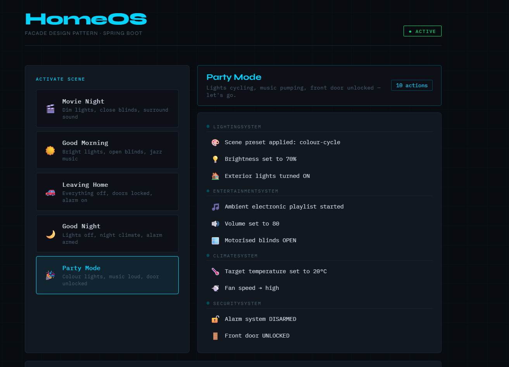

# 🏠 Facade Design Pattern — Spring Boot Demo

> A clean, portfolio-ready implementation of the **Facade Design Pattern** using **Java 17 + Spring Boot 3**, modelled as a Home Automation system.

---

## Pattern Overview

The **Facade Pattern** provides a **simplified, unified interface** to a set of interfaces in a subsystem.  
It defines a higher-level interface that makes the subsystem easier to use.

```
Client ──→ [ HomeAutomationFacade ] ──→ LightingSystem
                                    ──→ SecuritySystem
                                    ──→ ClimateSystem
                                    ──→ EntertainmentSystem
```

The client calls **one method** like `facade.activateMovieMode()`.  
The facade internally calls the right methods on the right subsystems in the right order — all hidden from the client.

---

## Project Structure

```
src/main/java/com/facade/
├── FacadeDemoApplication.java
│
├── subsystem/                          ← Complex subsystems (client never touches these directly)
│   ├── LightingSystem.java             — brightness, colour temp, scenes, motion sensors
│   ├── SecuritySystem.java             — arm/disarm, locks, cameras, perimeter alerts
│   ├── ClimateSystem.java              — HVAC, fan speed, eco/night modes, humidity
│   └── EntertainmentSystem.java        — TV, speakers, blinds, music
│
├── facade/
│   └── HomeAutomationFacade.java       ← THE FACADE — orchestrates all subsystems
│       ├── activateMovieMode()
│       ├── activateMorningMode()
│       ├── activateLeaveMode()
│       ├── activateSleepMode()
│       └── activatePartyMode()
│
├── model/
│   ├── SubsystemAction.java            — single low-level action record
│   └── FacadeResponse.java             — scene name + summary + action trace
│
└── controller/
    └── HomeController.java             ← Thin REST layer — only knows the Facade

frontend/
└── index.html                          ← Vanilla JS UI (zero deps)
```

---

## API Endpoints

### `POST /api/home/scene/{name}`
Activate a scene. `name` ∈ `movie | morning | leave | sleep | party`

**Response:**
```json
{
  "scene": "Movie Night",
  "summary": "Lights dimmed, blinds closed, surround sound active — enjoy the film.",
  "actions": [
    { "subsystem": "LightingSystem",      "action": "Brightness set to 15%",          "icon": "💡" },
    { "subsystem": "LightingSystem",      "action": "Scene preset applied: cinema-amber","icon": "🎨"},
    { "subsystem": "EntertainmentSystem", "action": "Motorised blinds CLOSED",         "icon": "🪟" },
    { "subsystem": "EntertainmentSystem", "action": "TV powered ON",                   "icon": "📺" },
    { "subsystem": "EntertainmentSystem", "action": "Surround sound system ACTIVE",    "icon": "🎧" },
    { "subsystem": "EntertainmentSystem", "action": "Volume set to 65",               "icon": "🔊" },
    { "subsystem": "ClimateSystem",       "action": "Target temperature set to 22°C", "icon": "🌡️" },
    { "subsystem": "ClimateSystem",       "action": "Fan speed → low",                "icon": "💨" },
    { "subsystem": "SecuritySystem",      "action": "Indoor cameras PAUSED (privacy mode)","icon": "🙈"}
  ]
}
```

### `GET /api/home/scenes`
Returns all available scenes with metadata.

---

## How to Run

### Backend
```bash
cd facade-demo
./mvnw spring-boot:run
# Runs at http://localhost:8080
```

### Frontend
Open `frontend/index.html` directly in a browser — no build step needed.

---

## Key Design Decisions

| Decision | Rationale |
|---|---|
| `@Service` on Facade | Spring manages lifecycle; subsystems injected via constructor |
| Each subsystem returns `List<SubsystemAction>` | Enables full chain tracing in response |
| Controller has zero subsystem imports | Proves the client never touches subsystems directly |
| `switch` expression in controller | Clean, readable scene routing (Java 17) |
| Zero frontend dependencies | Fast, no build tooling, easy to inspect |

---

## Without vs With Facade

**Without Facade** — the controller would need to:
- Import and understand 4 different subsystem classes
- Know which 9–10 specific methods to call for "Movie Night"
- Know the correct order of those calls
- Duplicate this knowledge for every new client

**With Facade** — the controller just calls:
```java
facade.activateMovieMode();
```

---

*GoF Facade Pattern · Backend Demo · Java 17 · Spring Boot 3*

